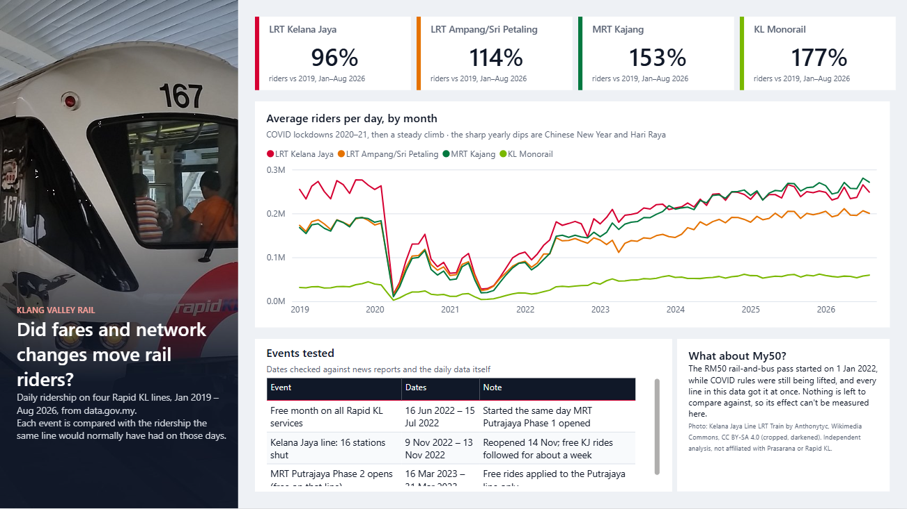
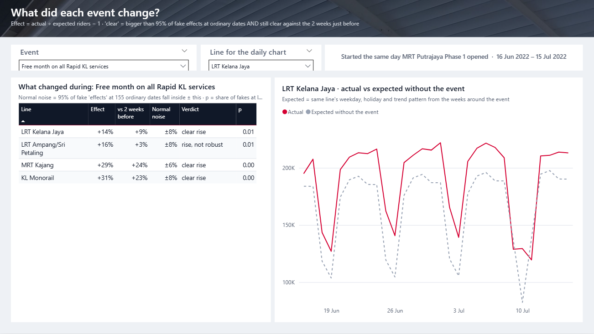
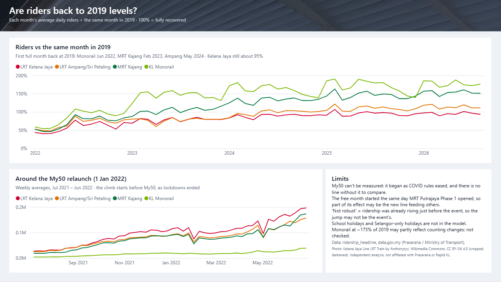

# Did fares and network changes move Klang Valley rail riders?

Daily ridership on four Rapid KL lines (LRT Kelana Jaya, LRT Ampang/Sri Petaling, MRT Kajang, KL Monorail),
1 Jan 2019 – 31 Aug 2026, from [data.gov.my](https://data.gov.my). For three dated events, each line's ridership is compared
with what it would normally have been on those days, and every "effect" is checked against the fake effects the same
method finds at 155 ordinary dates.



## Findings

| Event | Kelana Jaya | Ampang/Sri Petaling | MRT Kajang | Monorail |
|---|---|---|---|---|
| Free month on all Rapid KL services (16 Jun – 15 Jul 2022) | **+14.5%** clear | +16.4% not robust | **+29.1%** clear | **+31.2%** clear |
| Kelana Jaya line: 16 stations shut (9 – 13 Nov 2022) | **−81.5%** clear | **−17.9%** clear | −10.5% not robust | **+13.9%** clear |
| MRT Putrajaya Phase 2 opens, free on that line (16 – 31 Mar 2023) | +0.8% | +3.3% | +1.8% | −5.0% |

Normal noise is ±5.5% to ±13.5% depending on line and window length (`results/event_effects.csv`).

- **Free rides added riders.** Kelana Jaya, MRT Kajang and the Monorail rose well beyond normal noise. Ampang's +16%
  shrinks to +3% against the two weeks just before, when ridership was already climbing, so it is not counted.
  MRT Kajang's rise is partly the new Putrajaya line, which opened the same day and feeds it.
- **Riders switched lines in the shutdown.** Kelana Jaya lost about four in five riders; Ampang/Sri Petaling lost
  about 18% (it shares interchanges with Kelana Jaya), and the Monorail gained about 14%.
- **Putrajaya Phase 2 did not visibly change the other four lines** during its free fortnight.
- **Recovery is uneven.** Jan–Aug 2026 vs Jan–Aug 2019: Kelana Jaya 96%, Ampang/Sri Petaling 114%, MRT Kajang 153%,
  Monorail 177%. First full month back at 2019 level: Monorail Jun 2022, MRT Kajang Feb 2023, Ampang May 2024;
  Kelana Jaya has touched it but sits around 95%.
- **My50 can't be measured with this data.** The RM50 rail-and-bus pass started on 1 Jan 2022, while COVID rules were
  being lifted, and every line got it at once. Weekly ridership was already climbing from July 2021, so there is no
  clean before/after and no comparison line.

## Method

For each event and line (`scripts/01_analyse.py`):

1. Fit `log(riders)` on the 8 weeks before and weeks 3–10 after the event with day of week, KL public holidays,
   holiday eves, a Chinese New Year / Hari Raya festive week (−3 to +7 days), Ramadan (30 days before Hari Raya) and a
   linear trend. Days inside any event, or within 14 days after one, are left out.
2. Predict the event days (with Duan smearing) and take effect = total actual ÷ total expected − 1.
3. Run the same estimate at 155 placebo start dates (weekly, Jun 2023 – May 2026, away from events). The noise band
   is ±q, where q is the 95th percentile of the placebo effects' size, and p is the share of placebos at least as big.
4. **Robustness:** the last 14 training days before each event can already sit above or below the fitted line
   (`pre_resid`). The effect is re-expressed against that level (`effect_vs_pre`). A result is "clear" only if both
   versions are outside the band; otherwise "not robust".

Event dates come from news reports (linked in `data/events.csv`) and were checked against the daily data: the
Putrajaya line appears on 16 Jun 2022, its riders jump on 16 Mar 2023 and fall after 31 Mar, and Kelana Jaya drops
from ~190k to ~40k a day on 9–13 Nov 2022.

## Limits

- Three events and four lines: small, and the 2022 events fall in a fast post-COVID recovery that a linear trend only
  roughly follows.
- School holidays and Selangor-only holidays are not modelled. Ramadan is approximated as 30 days.
- The free month started the same day as MRT Putrajaya Phase 1, so its effect includes that new line feeding others.
- Monorail at ~175% of 2019 is unusually high and may partly reflect a change in how riders are counted; not checked.
- Lines that start after 2019 (MRT Putrajaya, LRT Shah Alam, KTM Komuter from Sep 2023) are not analysed.

## Power BI report

`powerbi/LRTRidership.pbip` (3 pages: Overview, Event effects, Recovery & My50), styled after the Klang Valley rail
map's line colours. It is **generated**: `scripts/02_export_bi.py` writes the CSVs, `scripts/03_build_pbip.py` writes
the TMDL model and PBIR report, and `scripts/check_pbir.py` validates every report file against Microsoft's published
schemas. Edit the scripts, not the PBIR. Open the `.pbip` in Power BI Desktop and click **Refresh**; if the CSVs moved,
set the `DataFolder` parameter to `powerbi/data`.

| Event effects | Recovery & My50 |
|---|---|
|  |  |

## Run

```powershell
python -m venv .venv
.venv\Scripts\python -m pip install -r requirements.txt
.\run_all.ps1      # download (if missing), analyse, export, build PBIP, validate, 8 tests; about 30 s
```

## Credits and licences

- Data: `ridership_headline`, [data.gov.my](https://data.gov.my) (Prasarana / Ministry of Transport), CC BY 4.0.
- Photo: [Kelana Jaya Line LRT Train](https://commons.wikimedia.org/wiki/File:Kelana_Jaya_Line_LRT_Train.jpg) by
  Anthonytyc, Wikimedia Commons, [CC BY-SA 4.0](https://creativecommons.org/licenses/by-sa/4.0/). The cropped,
  darkened versions in `assets/` (`hero_lrt.jpg`, `strip_lrt.jpg`) are shared under the same licence.
- This is an independent analysis, not affiliated with Prasarana or Rapid KL.
