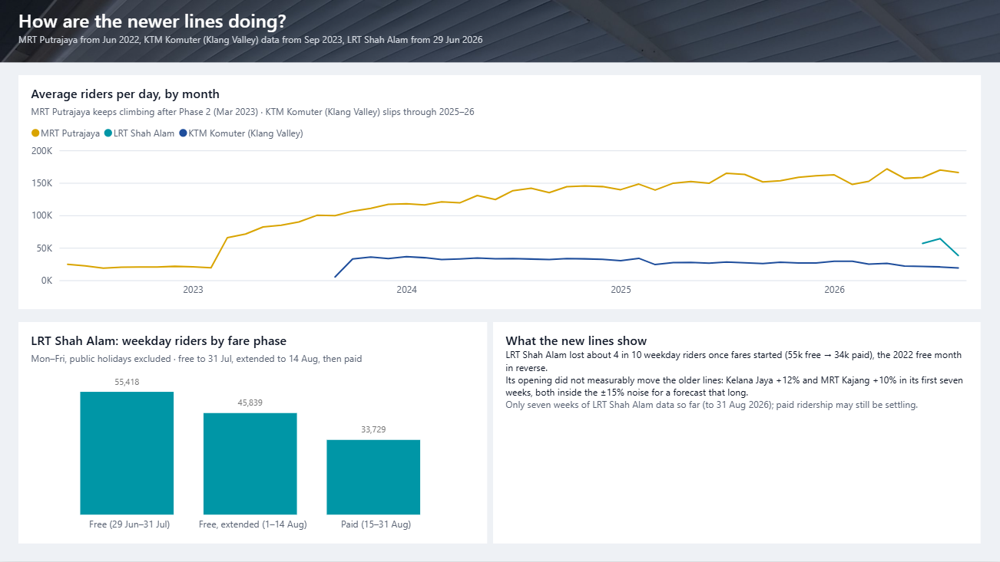

# Did fares and network changes move Klang Valley rail riders?

Daily ridership on Klang Valley rail, 1 Jan 2019 – 31 Aug 2026, from [data.gov.my](https://data.gov.my): LRT Kelana Jaya,
LRT Ampang/Sri Petaling, MRT Kajang and KL Monorail since 2019, plus MRT Putrajaya (from Jun 2022), KTM Komuter in the
Klang Valley (data from Sep 2023) and LRT Shah Alam / LRT3 (from 29 Jun 2026). For six dated events, each line's
ridership is compared with what it would normally have carried, and every effect is checked three ways.


## Findings

| Event | Kelana Jaya | Ampang/Sri Petaling | MRT Kajang | Monorail |
|---|---|---|---|---|
| My50 pass starts, first 4 weeks (Jan 2022) | +2.7% | +1.7% | −4.2% | −12.1% |
| Free month on all Rapid KL services (16 Jun – 15 Jul 2022) | +15.6% not robust | **+19.3%** clear | **+29.9%** clear | **+33.8%** clear |
| Kelana Jaya line: 16 stations shut (9 – 13 Nov 2022) | **−81.3%** clear | −17.9% not robust | −10.1% not robust | **+16.4%** clear |
| Ampang/Sri Petaling cut at Bandaraya, first 4 weeks (27 Jan 2023) | +5.3% | −14.5% | −0.3% | +20.5% not robust |
| MRT Putrajaya Phase 2 opens, free on that line (16 – 31 Mar 2023) | +1.0% | +1.0% | +2.9% | −3.6% |
| LRT Shah Alam opens, free to 14 Aug (29 Jun 2026) | +11.7% | +9.2% | +10.1% | +14.1% |

Unmarked cells are within normal noise. Noise is ±5% to ±15% for events with data on both sides and ±12% to ±19% for
permanent changes, which can only be fitted on the weeks before (`results/event_effects.csv`, with MRT Putrajaya for
the LRT3 opening: +7.9%, within noise).

- **Free fares add riders.** In the June 2022 free month, Ampang/Sri Petaling, MRT Kajang and the Monorail rose
  well beyond normal noise and passed both checks. Kelana Jaya's +15.6% did not hold up against the comparison line.
  When LRT Shah Alam's free rides ended, its weekday riders fell from **55,418** (free) to **45,839** (extension) to
  **33,729** (paid), about 4 in 10 lost.
- **Disruptions move riders between lines.** While Kelana Jaya was shut it lost 81% of riders and the Monorail gained
  16%. The Monorail's share of LRT riders stepped up in Nov 2022 and again in Feb 2023, when the Ampang line was cut,
  and stayed higher.
- **New lines did not visibly drain or feed the old ones.** MRT Putrajaya Phase 2 left the four older lines unchanged;
  LRT Shah Alam's first seven weeks are inside noise on every line.
- **My50 still can't be measured.** Its first four weeks are inside ±12–17% noise. The comparison line reads +28% to
  +49%, but that is an artifact: KTM Komuter Utara rose with December 2021 holiday travel and fell when schools reopened
  on 10 Jan 2022, and the 2021 school calendar could not be found.
- **Recovery is uneven.** Jan–Aug 2026 vs Jan–Aug 2019: Kelana Jaya 96%, Ampang/Sri Petaling 114%, MRT Kajang 153%,
  Monorail 177%. The Monorail's 2019 base was low: about 65,000 riders a day in 2015 fell to 36,000 after its two-car
  trains were withdrawn ([NST, 2020](https://nst.com.my/amp/news/nation/2020/07/605387/kl-monorail-daily-ridership-set-rise-65000-passengers)).

## Method

For each event and line (`scripts/01_analyse.py`):

1. Fit `log(riders)` on day of week, KL and Selangor public holidays, holiday eves, a Chinese New Year / Hari Raya
   festive week, Ramadan (exact start from the `Awal Ramadan` holiday), KL/Selangor school holidays
   (`data/school_holidays.csv`) and a linear trend. Short events use the 8 weeks before and weeks 3–10 after; permanent
   changes (My50, the Ampang cut, LRT3) use only the 8 weeks before. Days in or just after any event are left out.
2. Predict the event days (Duan smearing); effect = total actual ÷ total expected − 1.
3. **Noise band:** the same estimate at 120–145 placebo dates (weekly, Jun 2023 – May 2026), skipping any whose
   window touches an event or a known step change (3 MRT Kajang stations moved to MRT Putrajaya on 16 Jun 2022, the
   Ampang line reopened on 17 Feb 2024, LRT3 opened on 29 Jun 2026). Band = ±95th percentile of the placebo effects.
4. **Check 1, level just before:** the effect re-expressed against the last 14 training days before the event.
5. **Check 2, comparison line:** the same model on the ratio to KTM Komuter Utara (northern commuter rail: not Rapid
   KL, no Klang Valley fare offers, same post-COVID recovery), with its own placebo band.
6. "Clear" = beyond the noise band and both checks agree; otherwise "not robust" and `failed_checks` says which.

Event dates come from news reports (linked in `data/events.csv`) and were checked against the daily data.

## Limits, and what was done about them

| Limit in v1 | v2 |
|---|---|
| 2022 events sat in a fast post-COVID recovery that a linear trend only roughly follows | Comparison-line check against KTM Komuter Utara, which went through the same recovery; the Kelana Jaya free-month rise did not survive it |
| School and Selangor holidays not modelled; Ramadan fixed at 30 days | Selangor holidays and exact Ramadan added; school holidays 2022–26 added from unofficial calendars (each row has a confidence note); 2021 not found |
| The free month started with MRT Putrajaya Phase 1 | Phase 1's only Rapid KL interchange was with MRT Kajang (Kwasa Damansara), so the Ampang and Monorail rises are not new-line feeders; MRT Kajang's may partly be |
| Monorail at ~175% of 2019 unexplained | 2019 was a fleet-shortage low, and the Monorail kept riders it gained in the Kelana Jaya shutdown and Ampang cut |
| Lines opened after 2019 not analysed | MRT Putrajaya, KTM Komuter (Klang Valley) and LRT Shah Alam added; LRT3 opening tested as an event |

Still open: My50 (above); permanent changes can only detect effects above about ±12–19%; KTM Komuter Utara has its
own holiday pattern, so the comparison check is strict and can miss real effects; LRT Shah Alam has only seven weeks
of data; KTM Komuter (Klang Valley) starts in Sep 2023, too late to compare the 2022–23 events.

## Power BI report

`powerbi/LRTRidership.pbip`: 4 pages (Overview, Event effects, Recovery & My50, New lines), styled after the Klang
Valley rail map's line colours. It is **generated**: `scripts/02_export_bi.py` writes the CSVs, `scripts/03_build_pbip.py`
writes the TMDL model and PBIR report, and `scripts/check_pbir.py` validates every report file against Microsoft's
published schemas. Edit the scripts, not the PBIR. Open the `.pbip` in Power BI Desktop and click **Refresh**; if the
CSVs moved, set the `DataFolder` parameter to `powerbi/data` (or rebuild with `PBI_DATA_FOLDER` set).

| Event effects | Recovery & My50 | New lines |
|---|---|---|
|  |  |  |

## Run

```powershell
python -m venv .venv
.venv\Scripts\python -m pip install -r requirements.txt
.\run_all.ps1      # download (if missing), analyse, export, build PBIP, validate, 9 tests; about 2 minutes
```

## Credits and licences

- Data: `ridership_headline`, [data.gov.my](https://data.gov.my) (Prasarana / Ministry of Transport), CC BY 4.0.
- School holidays: compiled from public school-calendar posts (sources per row in `data/school_holidays.csv`), not an
  official KPM file.
- Photo: [Kelana Jaya Line LRT Train](https://commons.wikimedia.org/wiki/File:Kelana_Jaya_Line_LRT_Train.jpg) by
  Anthonytyc, Wikimedia Commons, [CC BY-SA 4.0](https://creativecommons.org/licenses/by-sa/4.0/). The cropped,
  darkened versions in `assets/` (`hero_lrt.jpg`, `strip_lrt.jpg`) are shared under the same licence.
- This is an independent analysis, not affiliated with Prasarana or Rapid KL.
